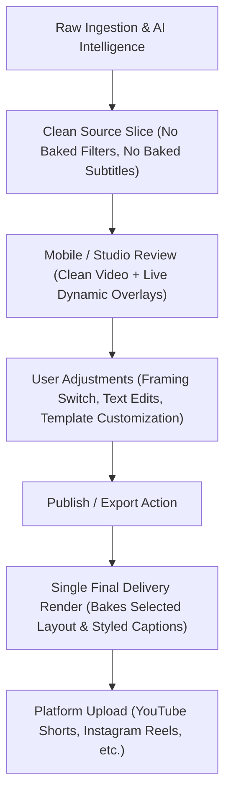

# Dispatch Canonical Architecture & Invariants
**Status:** Authoritative Repository Standard  
**Effective Date:** 2026-10-30  
**Scope:** Ingestion, Video Engine, Mobile UI / Studio Review, Captions, and Publishing Outbox.

---

## The 4-Step Lifecycle Model

Dispatch enforces a strict separation between **Interactive Review** and **Delivery Rendering**:

---

### Step 1: Ingestion (Clean Source Slice)
1. **AI Discovery:**
   - Whisper transcribes the audio chunk.
   - Gemini analyzes the transcript and identifies high-engagement hooks and candidate clip boundaries (`start_time` to `end_time`).
2. **Clean Slice Generation:**
   - The video engine slices an **untouched, progressive MP4 segment** (`+faststart`) directly from the source video.
   - **Zero Layout Baking:** The slice retains the pristine native aspect ratio (e.g., 16:9 widescreen 1920x1080) without pre-baked blurred bars, letterboxing, or pillarboxing.
   - **Zero Subtitle Burning:** Subtitles are **NEVER** burned into the review video during ingestion.
   - Subtitle timing and words are saved purely to the database (`caption_data`) as structured JSON (`CaptionTrack`).
   - The clip database record is marked with `rendered_layout_mode = NULL` (indicating an untouched source slice ready for dynamic UI framing).

---

### Step 2: Live Layout Framing (Zero Pre-Baking)
1. **Source Playback:**
   - The mobile app and desktop review studio play the **clean slice** directly (`storage/clips/{clip_id}.mp4`).
2. **Dynamic UI Framing:**
   - Tapping layout options switches UI CSS framing **instantly (0 ms)** without triggering background FFmpeg re-renders:
     - **Native 16:9:** Displays the raw 16:9 video in a 16:9 container (`aspect-[16/9]`, `object-contain`).
     - **9:16 Fit + Black:** Centers the 16:9 video inside a 9:16 black container (`object-contain`) with clean top and bottom black bars.
     - **9:16 Crop:** Centers and fills the 9:16 viewport (`object-cover object-center`), cleanly cropping horizontal sides.
     - **9:16 Fit + Blur:** Uses a real-time background blurred video layer (`object-cover blur-2xl brightness-75 scale-125`) behind the centered foreground video (`object-contain`).
3. **No Transform Distortion:**
   - The player container must never apply arbitrary CSS scale multipliers (e.g. `scale(3.16)` or `scale(1.778)`) that distort or stretch pre-baked bars.

---

### Step 3: Live Captions (Editable UI Overlay)
1. **Default Template Application:**
   - Captions are rendered as a **live vector/HTML UI overlay** (`DispatchCaptionRenderer`) directly on top of the video stage.
   - The overlay defaults to the user's active template configured in Template Studio (font family, colors, shadows, positioning, animation presets), strictly superseding any hardcoded fallbacks.
2. **Interactive Editing:**
   - Words, timestamps, colors, and layout positions are fully interactive and editable in real time.
   - Toggling caption visibility or modifying styling immediately reflects in the live UI overlay without modifying the underlying video file.

---

### Step 4: Final Delivery Render (Deferred Strictly to Publish / Export)
1. **Single Heavy Render:**
   - FFmpeg rendering with baked-in subtitles and aspect-ratio filter complexes is deferred **strictly until the user taps Publish or Export**.
2. **Delivery Pipeline:**
   - At publish time, the publisher outbox checks if a delivery-ready artifact matching the user's final approved settings exists.
   - If not, it executes a single delivery render:
     1. Trims the exact approved `start_time` and `end_time`.
     2. Builds the target layout framing filter (`fit_blur`, `fit_black`, or `crop_916`) for 1080x1920 (9:16) or target dimensions.
     3. Exports the user's customized `CaptionTrack` to an ASS subtitle file and burns it into the delivery stream.
     4. Normalizes audio to broadcast standards (`loudnorm=I=-14:LRA=11:TP=-1.5`).
     5. Uploads the final rendered artifact to the destination platform (YouTube Shorts, Instagram Reels, etc.).

---

## Architectural Invariants for Agents & Developers
1. **Never bake filters into review clips:** Any ingestion pathway (`catcher.py`, `worker.py`, manual upload) that saves a video for user review must produce an unbaked clean slice.
2. **Never burn subtitles into review clips:** Subtitle burning is exclusive to final delivery exports.
3. **Database Column Semantics:**
   - `layout_mode`: The user's intended target framing (e.g., `'fit_blur'`, `'fit_black'`, `'crop_916'`, `'native_169'`).
   - `rendered_layout_mode`: `NULL` for clean unbaked review slices; populated with layout string only if a delivery artifact has been baked.
4. **Biomechanical & Visual Standards:**
   - Mobile interactive elements must adhere to the 44px hitbox requirement.
   - Text hierarchy: 14px mobile body font, 12px metadata-only.
   - Timestamps and numeric values must strictly enforce `font-mono tabular-nums` and right alignment.
