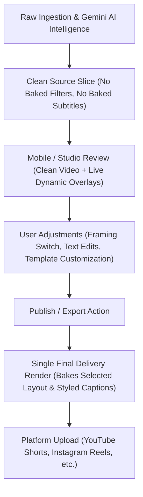

# Dispatch Canonical Architecture & Invariants (V2)
**Status:** Authoritative Repository Standard  
**Effective Date:** 2026-11-05  
**Version:** Dispatch V2 (`v1.7.29-alpha`, Android `versionCode = 97`)  
**Scope:** Ingestion, Video Engine, Mobile UI / Studio Review, Captions, and Publishing Outbox.  
> **Master Reference:** Full V2 topology, execution boundaries, and speech pipeline are documented in [DISPATCH_V2_ARCHITECTURE.md](docs/architecture/DISPATCH_V2_ARCHITECTURE.md).

---

## The 4-Step Lifecycle Model

Dispatch enforces a strict separation between **Interactive Review** and **Delivery Rendering**:

---

### Step 1: Ingestion (Clean Source Slice)
1. **AI Discovery:**
   - Canonical Gemini Speech Pipeline (Primary: `gemini-3.5-transcribe`, Fallback: `gemini-3.5-flash-lite`) transcribes the audio chunk with word-level millisecond timestamps and speaker diarization.
   - Zero local Whisper fallback. Zero YouTube captions fallback.
   - Gemini analyzes the transcript and identifies cohesive, thoughtful standalone candidate clip boundaries (`start_time` to `end_time`).
2. **Clean Slice Generation:**
   - The video engine slices an **untouched, progressive MP4 segment** (`+faststart`) directly from the source video.
   - **Zero Layout Baking:** The slice retains the pristine native aspect ratio (e.g., 16:9 widescreen 1920x1080) without pre-baked blurred bars, letterboxing, or pillarboxing.
   - **Zero Subtitle Burning:** Subtitles are **NEVER** burned into the review video during ingestion.
   - Subtitle timing and words are saved purely to the database (`caption_data`) as structured JSON (`CaptionTrack`).
   - The clip database record is marked with `rendered_layout_mode = NULL` (indicating an untouched source slice ready for dynamic UI framing).

---

### Step 2: Live Layout Framing (Zero Pre-Baking)
1. **Source Playback:**
   - The mobile app and desktop review studio play the **clean slice** directly (`storage/clips/{clip_id}.mp4`).
2. **Dynamic UI Framing:**
   - Tapping layout options switches UI CSS framing **instantly (0 ms)** without triggering background FFmpeg re-renders:
     - **Native 16:9:** Displays the raw 16:9 video in a 16:9 container (`aspect-[16/9]`, `object-contain`).
     - **9:16 Fit + Black:** Centers the 16:9 video inside a 9:16 black container (`object-contain`) with clean top and bottom black bars.
     - **9:16 Crop:** Centers and fills the 9:16 viewport (`object-cover object-center`), cleanly cropping horizontal sides.
     - **9:16 Fit + Blur:** Uses a real-time background blurred video layer (`object-cover blur-2xl brightness-75 scale-125`) behind the centered foreground video (`object-contain`).
3. **No Transform Distortion:**
   - The player container must never apply arbitrary CSS scale multipliers (e.g. `scale(3.16)` or `scale(1.778)`) that distort or stretch pre-baked bars.

---

### Step 3: Interactive Review Studio (Live Captions)
1. **Live Preview Overlays:**
   - Subtitles render in real time directly over the clean video via HTML/Canvas.
   - Font family, size, line breaks, word highlighting, pop/slide animations, and colors update immediately with 0 ms re-render lag.
2. **Deterministic EDL Timeline:**
   - Trimming, splitting, and ripple deletes manipulate the unified source-time EDL (`[start, end)`).
   - Stored captions remain anchored to source timeline time, allowing non-destructive cuts and timeline revisions.

---

### Step 4: Final Delivery Render
1. **Single Delivery Bake:**
   - Only upon user approval (`POST /api/clips/{id}/approve` or Android on-device export) is the final delivery video rendered.
   - Bakes the chosen aspect ratio framing and ASS subtitle tracks atomically with FFmpeg / Android Media3.
   - Validates that the rendered duration matches the effective kept duration of the EDL before transitioning the clip to `approved`.
2. **Outbox Publishing:**
   - The publishing outbox worker claims the finalized MP4 and uploads it to configured platforms (YouTube Shorts, Instagram Reels, etc.).
