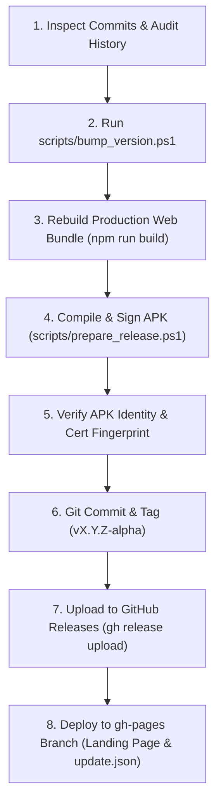

# Dispatch Versioning & Release Governance Guide

This document establishes the official semantic versioning standards, Android release invariants, and git history auditing procedures for the Dispatch platform.

---

## 1. The Core Versioning Standards (SemVer 2.0)

Dispatch strictly adheres to **Semantic Versioning (SemVer)**:
$$\text{MAJOR} \,.\, \text{MINOR} \,.\, \text{PATCH} \quad (\text{e.g., } 1.2.0)$$

### 1.1 When to Bump MAJOR ($X.0.0$)
Increment **MAJOR** when making breaking changes, architectural overhauls, or non-backward-compatible modifications:
- Breaking database migrations that wipe or fundamentally re-structure user sessions without backward compatibility.
- Major protocol or security key changes requiring all clients and servers to update simultaneously.
- Transitioning from Alpha/Beta to public v1.0.0 or v2.0.0 milestones.

### 1.2 When to Bump MINOR ($1.X.0$)
Increment **MINOR** (and reset **PATCH** to `0`) when adding new functionality in a backward-compatible manner:
- Adding major new functional subsystems (e.g., **Caption Template Studio**, **Continuous Zoom Slider Engine**, **Multi-Platform Publisher**).
- Adding new UI screens, workflows, or settings modules.
- Introducing new API endpoints or hardware capabilities while preserving existing behaviors.

### 1.3 When to Bump PATCH ($1.2.X$)
Increment **PATCH** when implementing backward-compatible bug fixes and small quality-of-life polish:
- Fixing UI bugs (e.g., timeline pre-selection handles, text clipping, layout alignment).
- Fixing background sync logic (e.g., WorkManager `ExistingWorkPolicy.REPLACE`).
- Minor styling polish, token adjustments, or documentation updates.

---

## 2. Android Version Invariants

Android enforces two independent version identifiers in `android/app/build.gradle.kts`:

```kotlin
defaultConfig {
    applicationId = "com.resolvia.dispatch"
    minSdk = 26
    targetSdk = 35
    versionCode = 28          // Int: SOLE update authority on Android
    versionName = "1.2.0"     // String: Human-facing SemVer
}
```

### 2.1 The Single Authority: `versionCode`
> **CRITICAL INVARIANT:**  
> In Android, the integer `versionCode` is the **sole update authority**. `versionName` is never compared by the operating system or the package installer.

1. **Strict Monotonicity:** Every single release or update **MUST** increment `versionCode` by at least $+1$ (e.g., $27 \rightarrow 28$).
2. **Rejection of Stale Builds:** If an APK is built with the same or lower `versionCode` than what is already installed on a physical phone, the Android OS and `DispatchUpdateManager` will reject the package as "Already Installed" or "Downgrade Not Permitted".
3. **No Code Reuse:** Once a `versionCode` is tagged or distributed to any device, it can never be reused.

---

## 3. How to Audit Past Commits

To determine the accurate version bump for a release, inspect the git commit history since the previous release tag:

### 3.1 Useful Git Commands
```bash
# View all recent commits with graph and tags
git log --oneline --graph --decorate -n 30

# View all commits introduced since the last release tag
git log $(git describe --tags --abbrev=0)..HEAD --oneline

# View file changes and diff statistics since the last release
git diff --stat $(git describe --tags --abbrev=0)..HEAD

# Filter commits by type (Conventional Commits)
git log $(git describe --tags --abbrev=0)..HEAD --grep="^feat" --oneline
git log $(git describe --tags --abbrev=0)..HEAD --grep="^fix" --oneline
```

### 3.2 Conventional Commits Mapping
| Commit Prefix | Scope | SemVer Impact |
| :--- | :--- | :--- |
| `feat:` / `feat(...):` | New feature or major capability | **MINOR bump** ($1.1.23 \rightarrow 1.2.0$) |
| `fix:` / `fix(...):` | Bug fix or issue resolution | **PATCH bump** ($1.2.0 \rightarrow 1.2.1$) |
| `BREAKING CHANGE:` / `!:` | Incompatible API or database change | **MAJOR bump** ($1.2.0 \rightarrow 2.0.0$) |
| `chore:`, `docs:`, `refactor:` | Internal maintenance | Grouped into current patch or minor |

---

## 4. Automated Version Bumping

The repository provides an automated script that audits recent commits and synchronizes version numbers across all project files:

```powershell
# Auto-detect bump type from git commits since the last tag:
powershell -File scripts\bump_version.ps1

# Or explicitly specify the bump type:
powershell -File scripts\bump_version.ps1 -Type minor
powershell -File scripts\bump_version.ps1 -Type patch
powershell -File scripts\bump_version.ps1 -Type major
```

### What `bump_version.ps1` Synchronizes
1. `android/app/build.gradle.kts` (`versionCode`, `versionName`)
2. `frontend/package.json` (`version`)
3. `site/update.json` (`versionCode`, `versionName`, `releaseTag`, `releaseNotes`)
4. `site/index.html` (Display version pills and release copy)
5. `README.md` (Current authoritative version badge)

---

## 5. End-to-End Release Checklist

Whenever an agent or engineer prepares a release, follow this sequential pipeline:



1. **Bump Version:**
   ```powershell
   powershell -ExecutionPolicy Bypass -File scripts\bump_version.ps1
   ```
2. **Build Web Bundle:**
   ```powershell
   cd frontend && npm run build && cd ..
   ```
3. **Assemble and Sign Release APK:**
   ```powershell
   cmd /c "set JAVA_HOME=C:\Program Files\Android\Android Studio\jbr&& powershell -ExecutionPolicy Bypass -File scripts\prepare_release.ps1"
   ```
4. **Commit & Tag:**
   ```bash
   git commit -am "chore(release): bump to v1.2.0-alpha (code 28)"
   git tag v1.2.0-alpha
   git push origin main --tags
   ```
5. **Publish to GitHub Releases:**
   ```bash
   gh release create v1.2.0-alpha release-out/Dispatch.apk release-out/update.json --title "Dispatch 1.2.0 Alpha" --notes "Release 1.2.0 with Template Studio, continuous zoom dial, pause recording, and upload queue engine."
   ```
6. **Deploy to GitHub Pages:**
   Sync `site/index.html`, `site/update.json`, and root `update.json` to the `gh-pages` branch and push to `origin/gh-pages`.
